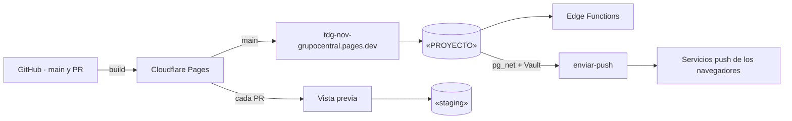

# Despliegue (v1.0)

Cómo llega el código a producción, dónde vive cada pieza y qué guarda cada secreto. Los pasos
detallados están en las guías de [`docs/despliegue/`](../despliegue/), y las razones en los ADR
0004, 0005, 0011 y 0012. El SDD lo trata en 4.2.11 y 5.3.7.

## Dónde vive cada pieza



| Pieza                         | Producción                                                                  | Desarrollo y vistas previas                           |
| ----------------------------- | --------------------------------------------------------------------------- | ----------------------------------------------------- |
| Aplicación (PWA estática)     | Cloudflare Pages, rama `main`                                               | Una vista previa por PR; `npm run dev` en local       |
| Base de datos, Auth y Storage | «PROYECTO» (`lyrdsmfalrchbdpmikmt`)                                         | «staging» (`qxjnnanjidytbyihanet`), compartido        |
| Edge Functions                | `gestionar-usuario`, `restablecer-contrasena` y `enviar-push` en «PROYECTO» | Las mismas en «staging» (`npm run staging:functions`) |
| CI                            | GitHub Actions en cada PR y en `main`                                       | Supabase local con Docker, en el CI                   |

Cloudflare Pages solo sirve archivos: no hay Workers ni funciones de Pages (ADR 0004). Todo lo
que necesita el servidor está en Supabase.

## Variables y secretos

El repositorio es público. **Ningún valor secreto va en él**, ni en `.env.example`, ni en un
commit, ni en la salida de un comando.

| Nombre                                                   | Dónde se pone                                               | ¿Secreto?                               |
| -------------------------------------------------------- | ----------------------------------------------------------- | --------------------------------------- |
| `VITE_SUPABASE_URL`                                      | Pages (Production y Preview) y `.env.local`                 | No                                      |
| `VITE_SUPABASE_PUBLISHABLE_KEY`                          | Pages (Production y Preview) y `.env.local`                 | No: es la clave publicable              |
| `VITE_VAPID_PUBLIC_KEY`                                  | Pages (Production y Preview) y `.env.local`                 | No: es la clave pública del push        |
| `VAPID_PUBLIC_KEY`, `VAPID_PRIVATE_KEY`, `VAPID_SUBJECT` | Secretos de la función `enviar-push` en cada proyecto       | **La privada, sí**                      |
| `ENVIAR_PUSH_SECRETO`                                    | Secreto de `enviar-push` y, en Vault, `enviar_push_secreto` | **Sí**                                  |
| `enviar_push_url`                                        | Vault de cada proyecto                                      | No, pero va junto al secreto            |
| `SUPABASE_SECRET_KEYS` (la clave secreta)                | La inyecta la plataforma a las Edge Functions               | **Sí**: nunca se escribe en ningún lado |
| `CLAVE_USUARIOS_DE_PRUEBA`                               | Solo `.env.local` de cada persona (usuarios de «staging»)   | **Sí**                                  |

- **Las claves push** se generan con `npm run vapid:claves`. Para «staging» se escriben en
  `.env.local`; para «PROYECTO», con `--archivo .env.proyecto.local`, que Git también ignora. No
  se imprimen.
- **Cada proyecto tiene las suyas.** Cambiar la pública invalida las suscripciones de ese
  proyecto.
- **El CI** usa la pública del ejemplo del RFC 8291 y no tiene Vault: no envía pushes.

## Cómo llega un cambio a producción

1. **PR hacia `main`.**
   - El CI corre cuatro trabajos: la app (lint, formato, unitarias y build), las Edge Functions
     (`deno check`), la base (migraciones y pgTAP) y las de extremo a extremo (Chromium y WebKit).
     Cloudflare Pages publica además una vista previa.
   - El compañero revisa.
2. **La migración, si el PR trae una,** se prueba en «staging» al hacerla. A «PROYECTO» llega
   **justo antes de fusionar**, porque Pages publica `main` enseguida y el código no puede llegar
   antes que su base. La aplica una persona, con el OK de la review:

   ```bash
   npx supabase db push --project-ref lyrdsmfalrchbdpmikmt --dry-run
   ```

   ```bash
   npx supabase db push --project-ref lyrdsmfalrchbdpmikmt
   ```

   El simulacro debe listar solo las migraciones de ese PR. Después, otro simulacro («Remote
   database is up to date») y el asesor.

3. **Las Edge Functions** que cambiaron, también antes de fusionar:

   ```bash
   npx supabase functions deploy <nombre> --use-api --project-ref lyrdsmfalrchbdpmikmt
   ```

   `verify_jwt` sale de `supabase/config.toml`: `gestionar-usuario` lo exige, y
   `restablecer-contrasena` y `enviar-push` no (se protegen solas).

4. **Squash merge** hecho por una persona. Pages publica `main`.
5. **Etiqueta** al cierre del sprint, con el OK del equipo.

La v1.0 sigue estos mismos pasos, en orden y con sus comprobaciones:
[`docs/despliegue/produccion-v1.0.md`](../despliegue/produccion-v1.0.md).

## Guías

| Guía                                                                       | Qué cubre                                                                                                                  |
| -------------------------------------------------------------------------- | -------------------------------------------------------------------------------------------------------------------------- |
| [`cloudflare-pages.md`](../despliegue/cloudflare-pages.md)                 | El build, las tres variables por entorno, la URL de producción en Auth y cómo verificar una publicación                    |
| [`supabase-auth.md`](../despliegue/supabase-auth.md)                       | Auth (registro cerrado, contraseña, sesión y URL), la API de datos, las claves, las Edge Functions y el push en «PROYECTO» |
| [`produccion-v1.0.md`](../despliegue/produccion-v1.0.md)                   | La lista de la v1.0: migraciones, función, secretos, Vault, la variable de Pages, fusiones y etiquetas                     |
| [`docs/pruebas/sesion-sin-conexion.md`](../pruebas/sesion-sin-conexion.md) | Cómo se probó la sesión sin conexión                                                                                       |

## Si algo sale mal

- **La aplicación:** Pages permite volver a una publicación anterior desde su lista de
  publicaciones (**Rollback**). Es inmediato y no toca la base.
- **La base:** las migraciones solo avanzan. Lo que haya que deshacer se escribe en una migración
  nueva (`supabase migration new`), se prueba en «staging» y sigue el mismo camino. Antes del
  piloto conviene un respaldo de «PROYECTO» con `npx supabase db dump` (plan de arranque); lo hace
  una persona y el archivo no va al repositorio.
- **El push:** si no llega, los avisos dentro de la aplicación siguen funcionando (CU-31 2a). Los
  logs de `enviar-push` están en el panel de Supabase (**Edge Functions → enviar-push → Logs**).
