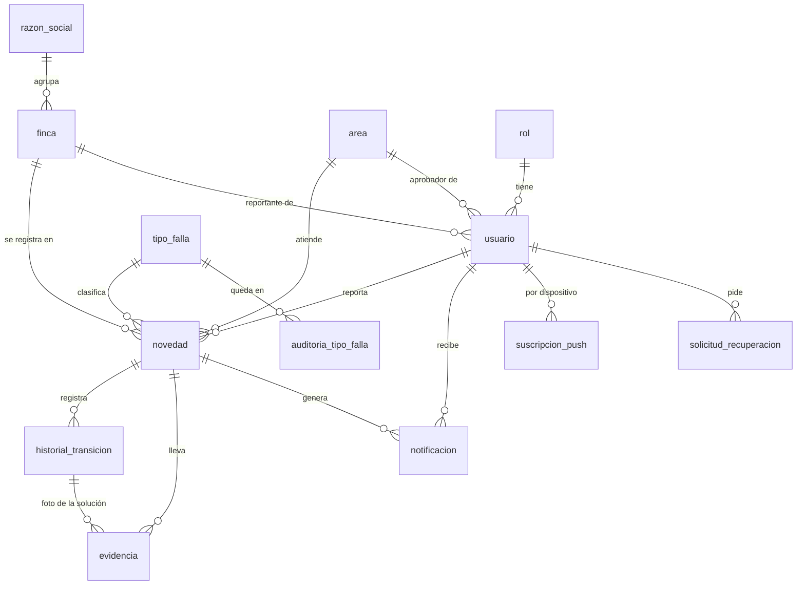

# Modelo de datos (v1.0)

PostgreSQL 17 en Supabase, con 34 migraciones en `supabase/migrations/`, de
`20261007042045_s0_extensiones_tipos` a `20261019124519_rf31_webhook_notificacion`. El diseño
está en el SDD:

- 6.1.1: entidades (Tabla 26) e índices (Tabla 27);
- 6.1.2 y 6.1.3: estados, transiciones y funciones de transición (Tablas 28 a 30);
- 6.1.4: políticas por tabla (Tabla 31);
- 5.3.2: la API de datos, las funciones RPC y los códigos de error (Tablas 20 a 22).

Esta página describe **lo construido**. Se leyó de «staging» el 19 oct 2026. Lo que se apartó del
SDD está en [`docs/cambios-sdd.md`](../cambios-sdd.md), y los tipos generados en
`src/core/supabase/database.types.ts`.

## Relaciones

`usuario.id` es el mismo de `auth.users`: el perfil se crea con la cuenta, desde la Edge Function
`gestionar-usuario`.

## Tablas

Las 13 tienen RLS. Una columna con `?` admite nulo.

| Tabla                    | Para qué                                                                    | Columnas                                                                                                                                                                                                                                                                     | Quién escribe                                                                    |
| ------------------------ | --------------------------------------------------------------------------- | ---------------------------------------------------------------------------------------------------------------------------------------------------------------------------------------------------------------------------------------------------------------------------- | -------------------------------------------------------------------------------- |
| `rol`                    | Roles fijos: 1 reportante, 2 aprobador de área, 3 director, 4 administrador | `id smallint`, `nombre`                                                                                                                                                                                                                                                      | Las migraciones                                                                  |
| `razon_social`           | Razones sociales del grupo                                                  | `id`, `nombre` (única), `activo`                                                                                                                                                                                                                                             | Por SQL, una vez (punto 1 de las decisiones pendientes)                          |
| `finca`                  | Fincas (RF-04); se desactivan, no se borran                                 | `id`, `razon_social_id`, `nombre` (único por razón social), `activo`, `creado_en`                                                                                                                                                                                            | El administrador, por la API (pantalla 30)                                       |
| `area`                   | Áreas responsables: Mantenimiento y Sistemas                                | `id`, `nombre` (única), `activo`                                                                                                                                                                                                                                             | Las migraciones                                                                  |
| `usuario`                | Perfil de cada cuenta (RF-03)                                               | `id` (= `auth.users`), `nombre`, `correo` (único, no se expone), `rol_id`, `finca_id?`, `area_id?`, `activo`, `creado_en`                                                                                                                                                    | `gestionar-usuario` (Edge Function)                                              |
| `novedad`                | La novedad (RF-05)                                                          | `id`, `codigo bigint` (secuencia, `NOV-####`), `id_local` (único: idempotencia), `finca_id`, `area_id`, `reportante_id`, `tipo_falla_id?`, `descripcion`, `prioridad`, `estado`, `solucion?`, `fecha_ejecucion?`, `fecha_registro`, `fecha_sincronizacion`, `actualizado_en` | **Solo las funciones RPC**                                                       |
| `historial_transicion`   | Historial inmutable de estados y áreas (RF-16, RNF-12)                      | `id bigint`, `novedad_id`, `usuario_id`, `estado_anterior?`, `estado_nuevo`, `area_anterior_id?`, `area_nueva_id?`, `observacion?`, `fecha_hora`                                                                                                                             | **Solo las funciones RPC**; un disparador impide `UPDATE`, `DELETE` y `TRUNCATE` |
| `notificacion`           | Avisos dentro de la aplicación (RF-30)                                      | `id`, `destinatario_id`, `novedad_id`, `estado_nuevo`, `leida`, `creada_en`, `leida_en?`                                                                                                                                                                                     | **Solo las funciones RPC** (`private.avisar` y `marcar_avisos_leidos`)           |
| `tipo_falla`             | Catálogo de tipos de falla (RF-14, RF-32)                                   | `id`, `nombre`, `nombre_normalizado` (único), `activo`, `creado_por`, `creado_en`                                                                                                                                                                                            | Las funciones RPC (`registrar_solucion` y las cuatro del catálogo)               |
| `auditoria_tipo_falla`   | Quién renombró, fusionó o desactivó un tipo y cuándo (RF-32)                | `id`, `tipo_falla_id`, `tipo_destino_id?`, `usuario_id`, `accion`, `valor_anterior?`, `fecha`                                                                                                                                                                                | Las funciones del catálogo                                                       |
| `evidencia`              | Fotos del bucket `evidencias` (RF-08)                                       | `id`, `novedad_id`, `subida_por`, `ruta_storage` (única), `tamano_bytes`, `subida_en`, `transicion_id?` (la solución a la que pertenece)                                                                                                                                     | El cliente inserta; el disparador valida y completa                              |
| `suscripcion_push`       | Suscripciones push de cada dispositivo (RF-31)                              | `id`, `usuario_id`, `endpoint` (único), `p256dh`, `auth`, `creada_en`                                                                                                                                                                                                        | El cliente, solo las propias; `enviar-push` borra las vencidas                   |
| `solicitud_recuperacion` | Recuperación de contraseña mediada por el administrador (RF-02)             | `id`, `usuario_id`, `codigo_hash?`, `expira_en?`, `usado`, `creada_en`, `intentos_fallidos` (0 a 5)                                                                                                                                                                          | Las funciones de recuperación                                                    |

**Restricciones que sostienen reglas del negocio:**

- `usuario_alcance_segun_rol`:
  - el reportante tiene finca y no área;
  - el aprobador tiene área y no finca;
  - el director y el administrador no tienen ninguna de las dos.
- `novedad_resuelta_completa`: una novedad resuelta o cerrada tiene tipo de falla, solución y fecha
  de ejecución.
- `novedad_descripcion_valida`: no vacía, hasta 500 caracteres.
- `solicitud_recuperacion_codigo_con_vencimiento`: el código y su vencimiento existen juntos.

## Tipos enumerados

| Tipo                | Valores                                                                                             |
| ------------------- | --------------------------------------------------------------------------------------------------- |
| `estado_novedad`    | `registrada`, `asignada`, `en_atencion`, `escalada`, `aprobada`, `rechazada`, `resuelta`, `cerrada` |
| `prioridad_novedad` | `critico`, `alto`, `normal`, `bajo` (el orden es el de la bandeja)                                  |
| `accion_auditoria`  | `renombrar`, `fusionar`, `desactivar`                                                               |

«Pendiente de sincronizar» no es un estado de la base: solo existe en el dispositivo.

## Vistas

Las tres son `security_invoker`: leen con los permisos de quien consulta, y las políticas de las
tablas se aplican igual.

| Vista             | Qué agrega                                                                                                                                                                                                   |
| ----------------- | ------------------------------------------------------------------------------------------------------------------------------------------------------------------------------------------------------------ |
| `v_novedad`       | La novedad con su finca, razón social, área, tipo de falla y reportante, y `resuelta_en`, la fecha de la última resolución (cambio 25). La usan la bandeja, Mis novedades, el historial, el CSV y el detalle |
| `v_finca`         | La finca con su razón social, sus novedades abiertas y sus reportantes activos (pantalla 30)                                                                                                                 |
| `usuario_publico` | Nombre, rol y área de las personas que aparecen en las líneas de tiempo, sin el correo                                                                                                                       |

## Funciones RPC (`public`)

Todo cambio de estado pasa por una de ellas.

- Las que escriben son `security definer` y verifican por sí mismas la identidad, el rol, que el
  usuario esté activo y el alcance.
- Bloquean la novedad (`for update`) y escriben el historial y los avisos en la misma transacción.
- Tienen `search_path` vacío. `execute` es solo para `authenticated`, con dos excepciones:
  `solicitar_recuperacion` también la ejecuta `anon` (ADR 0013) y `consumir_codigo_recuperacion`
  solo `service_role`.

| Función                                                                                 | Rol                      | Qué hace                                                                                       |
| --------------------------------------------------------------------------------------- | ------------------------ | ---------------------------------------------------------------------------------------------- |
| `registrar_novedad`                                                                     | Reportante               | Registra y enruta al área (registrada → asignada). Idempotente por `p_id_local`                |
| `tomar_novedad`                                                                         | Aprobador                | asignada → en_atencion                                                                         |
| `rechazar_novedad`                                                                      | Aprobador                | asignada o en_atencion → rechazada, con motivo                                                 |
| `reasignar_novedad`                                                                     | Aprobador                | A otra área (→ asignada), con motivo                                                           |
| `escalar_novedad`                                                                       | Aprobador                | en_atencion → escalada, con justificación                                                      |
| `decidir_escalamiento`                                                                  | Director                 | escalada → aprobada o rechazada; la observación es obligatoria al rechazar                     |
| `registrar_solucion`                                                                    | Aprobador                | en_atencion o aprobada → resuelta, con solución, fecha y tipo de falla (existente o nuevo)     |
| `confirmar_resolucion`                                                                  | Reportante               | resuelta → cerrada                                                                             |
| `reportar_falla_persiste`                                                               | Reportante               | resuelta → en_atencion, con observación                                                        |
| `corregir_tipo_falla`                                                                   | Administrador            | Cambia el tipo de una cerrada; queda «cerrada → cerrada» en el historial                       |
| `sugerir_tipos_falla`                                                                   | Aprobador, administrador | Tipos activos parecidos al texto, con su cantidad de novedades                                 |
| `renombrar_tipo_falla`, `fusionar_tipos_falla`, `desactivar_tipo_falla`                 | Administrador            | El catálogo (RF-32), con auditoría. La fusión pasa todas las novedades al destino              |
| `marcar_avisos_leidos`                                                                  | Todos                    | Marca los avisos propios (nulo = todos) y devuelve cuántos                                     |
| `listar_usuarios`                                                                       | Administrador            | Usuarios con su correo y su último ingreso                                                     |
| `solicitar_recuperacion`                                                                | Sin sesión (`anon`)      | Registra la solicitud; responde igual exista o no el correo (ADR 0013)                         |
| `generar_codigo_recuperacion`                                                           | Administrador            | El código de seis dígitos, una sola vez; en la base queda su resumen                           |
| `consumir_codigo_recuperacion`                                                          | Solo `service_role`      | La usa `restablecer-contrasena`                                                                |
| `rpt_novedades_abiertas`, `rpt_tiempos_atencion`, `rpt_escalamiento`, `rpt_recurrencia` | Director, administrador  | Los indicadores del panel (SDD 6.1.9, Tabla 34), en `jsonb`. Son `security invoker` y `stable` |

La forma del `jsonb` de cada indicador está en el comentario de su función
(`\df+ public.rpt_*`). Los errores son los de la Tabla 22, más los del cambio 17
(`LIMITE_DE_FOTOS`, `EVIDENCIA_INVALIDA`) y del cambio 30 (`TIPO_FALLA_DUPLICADO`). El cliente
los traduce en `src/core/errores/traducir.js`.

## Auxiliares (`private`)

El esquema `private` no se expone por la API.

| Función                                              | Para qué                                                                                             |
| ---------------------------------------------------- | ---------------------------------------------------------------------------------------------------- |
| `fn_rol`, `fn_finca`, `fn_area`, `fn_activo`         | El perfil de quien consulta, para las políticas (se evalúan una vez con `(select …)`)                |
| `puede_ver_novedad`                                  | El alcance de lectura de una novedad, por rol                                                        |
| `perfil_para_transicion`, `novedad_para_transicion`  | El perfil activo con el rol pedido y la novedad bloqueada dentro de su alcance; si no, `SIN_PERMISO` |
| `texto_obligatorio`, `texto_opcional`                | Recortan el texto y controlan los 500 caracteres (`DATO_OBLIGATORIO`)                                |
| `avisar`, `aprobadores_del_area`, `usuarios_del_rol` | Los avisos de cada transición, con los destinatarios de la Tabla 30, sin avisar a quien actúa        |
| `normalizar_tipo_falla`, `resolver_tipo_falla`       | El nombre normalizado y el tipo con que queda una solución (el destino de una fusión)                |
| `solicitud_abierta`                                  | Si una solicitud de recuperación sigue abierta                                                       |
| `novedad_de_la_ruta`, `solucion_vigente`             | La novedad de una ruta del bucket y la transición de la solución vigente                             |

## Disparadores

| Disparador                                                               | Tabla                  | Qué hace                                                                                                                                                           |
| ------------------------------------------------------------------------ | ---------------------- | ------------------------------------------------------------------------------------------------------------------------------------------------------------------ |
| `historial_transicion_sin_cambios` y `historial_transicion_sin_truncate` | `historial_transicion` | Rechazan `UPDATE`, `DELETE` y `TRUNCATE` (RNF-12)                                                                                                                  |
| `novedad_actualizado_en`                                                 | `novedad`              | Pone `actualizado_en`                                                                                                                                              |
| `evidencia_valida`                                                       | `evidencia`            | Valida quién adjunta, el estado y el máximo de 3 por grupo. Comprueba que el archivo exista en la carpeta de la novedad y toma su tamaño real (`security definer`) |
| `notificacion_push`                                                      | `notificacion`         | Encola con `pg_net` el POST a `enviar-push` por cada aviso nuevo, con la URL y el secreto de Vault; sin ellos no hace nada (`security definer`, cambio 33)         |

## Acceso

- **RLS en las 13 tablas.**
  - Las políticas son `TO authenticated`, con un predicado de alcance por rol.
  - Todo `UPDATE` tiene `USING` y `WITH CHECK`.
  - Ninguna usa `user_metadata`.
- **El cliente no escribe** en `novedad`, `historial_transicion` ni `notificacion`. Escribe
  directamente solo en:
  - `finca`: el administrador;
  - `evidencia`: con el disparador;
  - `suscripcion_push`: las propias.
- **Privilegios explícitos:** cada tabla empieza con `revoke all … from anon, authenticated`, y
  cada migración escribe sus `grant`.
  - `service_role` tiene solo lo que usan las Edge Functions: leer los datos del aviso y leer y
    borrar suscripciones.
- **Storage:**
  - el bucket `evidencias` es privado, de 1 MB por archivo y solo `image/jpeg`;
  - se lee un archivo solo si se puede leer su fila de `evidencia`;
  - nadie modifica ni borra.
- **Asesor de Supabase:** 21 avisos _WARN_ en «staging», todos de tipos conocidos (punto 16 de las
  decisiones pendientes). Ninguno de nivel de error.

Las razones están en el ADR 0010 y en las reglas 1 a 6 de `CLAUDE.md`.

## En el dispositivo (IndexedDB)

`novedades-grupo-central`, versión 1 (`src/core/offline/bd.js`, SDD Tabla 32):

| Almacén      | Clave      | Qué guarda                                                                                         |
| ------------ | ---------- | -------------------------------------------------------------------------------------------------- |
| `pendientes` | `id_local` | Las novedades registradas sin conexión, con su fecha real, hasta que se sincronizan (RF-21, RF-22) |
| `novedades`  | `id`       | Las listas y los detalles abiertos con red, para consultarlos sin ella (RF-24)                     |
| `catalogos`  | —          | Las áreas y la finca del reportante, para registrar sin conexión                                   |
| `meta`       | —          | El perfil de quien descargó, la última sincronización y si ya se ofreció el push (10-B)            |

Todo es por usuario y se borra si cambian el usuario, el rol o el alcance. El service worker no
guarda nada de Supabase.

## Cómo se cambia

1. `npx supabase migration new rfNN_lo_que_hace` (el archivo lo crea el CLI).
2. La migración con sus `grant`, sus políticas y su prueba pgTAP en `supabase/tests/`.
3. En «staging»: `npm run staging:reset && npm run staging:test && npm run staging:types && npm
run staging:advisors`. Los tipos regenerados van en el mismo commit.
4. A «PROYECTO», justo antes de fusionar el PR, con el OK del equipo: ver
   [`despliegue.md`](despliegue.md).
